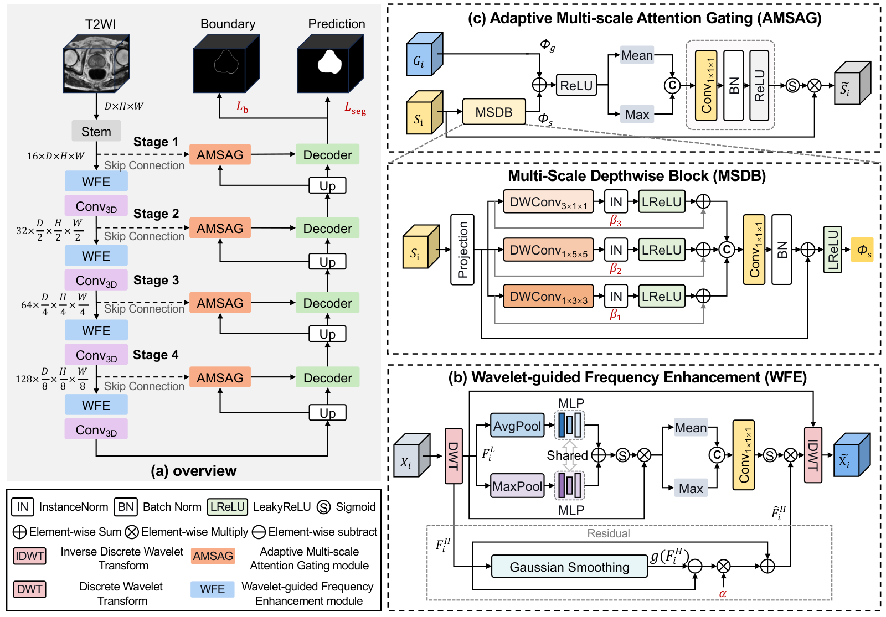

<h1 align="center">ProFG-Net</h1>
<p align="center">A frequency-guided biomedical image segmentation network built on nnU-Net v2.</p>
<p align="center">
  <a href="#english"></a>
  <a href="#chinese"></a>
</p>

<a id="english"></a>
# English

ProFG-Net is a frequency-guided segmentation network for biomedical images. It extends nnU-Net v2 with three components:

- Wavelet Frequency Enhancement (WFE) that emphasizes high-frequency structural information;
- Complementary Multi-Scale Attention Gate (CMSAG) that fuses skip connections at multiple scales;
- a boundary auxiliary supervision head that encourages accurate organ/lesion boundaries.

The default proposed trainer is `DIYBoundaryAdaptiveCMSAGAuxTrainer`, which uses the adaptive `W_x` block. Two closely related variants are also provided:

| Trainer | Description |
| --- | --- |
| `DIYBoundaryAdaptiveCMSAGAuxTrainer` | ProFG-Net (default): WFE + CMSAG with adaptive `W_x` + boundary auxiliary supervision |
| `DIYBoundaryCMSAGAuxTrainer` | Non-adaptive full model: WFE + CMSAG + boundary auxiliary supervision |
| `LearnableDIYBoundaryAdaptiveCMSAGAuxTrainer` | Learnable-wavelet version of ProFG-Net |

## Model overview



[Download the model diagram (PDF)](overview.pdf)

## Requirements

```bash
pip install nnunetv2 torch monai SimpleITK numpy scipy tqdm
```

For PI-CAI style lesion detection metrics, also install:

```bash
pip install picai_eval report_guided_annotation picai_baseline
```

## 1. Training

First set the nnU-Net environment variables and preprocess the dataset:

```bash
export nnUNet_raw=/path/to/nnUNet_raw
export nnUNet_preprocessed=/path/to/nnUNet_preprocessed
export nnUNet_results=/path/to/nnUNet_results

nnUNetv2_plan_and_preprocess -d 141 --verify_dataset_integrity
```

Then train the default ProFG-Net model:

```bash
CUDA_VISIBLE_DEVICES=0 nnUNetv2_train 141 3d_fullres 0 \
    -tr DIYBoundaryAdaptiveCMSAGAuxTrainer
```

Replace `141` with your dataset ID and `3d_fullres` with the nnU-Net configuration you want. To use a different model variant, change `-tr` to `DIYBoundaryCMSAGAuxTrainer` or `LearnableDIYBoundaryAdaptiveCMSAGAuxTrainer`.

## 2. Inference

Run inference with the best checkpoint:

```bash
CUDA_VISIBLE_DEVICES=0 nnUNetv2_predict \
    -i /path/to/imagesTs \
    -o /path/to/output \
    -d 141 \
    -c 3d_fullres \
    -tr DIYBoundaryAdaptiveCMSAGAuxTrainer \
    -f 0 \
    -chk checkpoint_best.pth
```

Add `--save_probabilities` if you need softmax probability maps for downstream analysis.

## 3. Evaluation metrics

Compute segmentation metrics (Dice, IoU, HD95, sensitivity, precision):

```bash
python compute_seg_metrics.py \
    --pred_dir /path/to/output \
    --gt_dir /path/to/labelsTs \
    --output_name proFG_net_metrics.json
```

For PI-CAI lesion detection evaluation, use:

```bash
python detection_tool/eval.py \
    --task Dataset2302_FullPI-CAI \
    --trainer UNetDetectionTrainer \
    --workdir /path/to/nnUNetv2 \
    --task_dir /path/to/inference_output \
    --checkpoints checkpoint_best
```

The main trainer and network implementations are under `nnunetv2/training/nnUNetTrainer/FreGNetTrain/`.

<a id="chinese"></a>
# 中文

ProFG-Net 是一个面向生物医学图像的频域引导分割网络，基于 nnU-Net v2 构建，包含三个核心模块：

- 小波频域增强（WFE），强化高频结构信息；
- 互补多尺度注意力门控（CMSAG），融合多尺度跳跃连接；
- 边界辅助监督头，提升器官或病灶边界精度。

默认提出的训练器为 `DIYBoundaryAdaptiveCMSAGAuxTrainer`，使用自适应 `W_x` 模块。同时提供两个紧密相关的变体：

| 训练器 | 说明 |
| --- | --- |
| `DIYBoundaryAdaptiveCMSAGAuxTrainer` | ProFG-Net（默认）：WFE + 自适应 `W_x` 的 CMSAG + 边界辅助监督 |
| `DIYBoundaryCMSAGAuxTrainer` | 非自适应完整模型：WFE + CMSAG + 边界辅助监督 |
| `LearnableDIYBoundaryAdaptiveCMSAGAuxTrainer` | ProFG-Net 的可学习小波版本 |

## 模型概览


[下载模型图（PDF）](overview.pdf)

## 环境依赖

```bash
pip install nnunetv2 torch monai SimpleITK numpy scipy tqdm
```

如需进行 PI-CAI 风格的病灶检测指标评估，还需安装：

```bash
pip install picai_eval report_guided_annotation picai_baseline
```

## 1. 训练代码

首先设置 nnU-Net 环境变量并对数据集进行预处理：

```bash
export nnUNet_raw=/path/to/nnUNet_raw
export nnUNet_preprocessed=/path/to/nnUNet_preprocessed
export nnUNet_results=/path/to/nnUNet_results

nnUNetv2_plan_and_preprocess -d 141 --verify_dataset_integrity
```

然后训练默认的 ProFG-Net 模型：

```bash
CUDA_VISIBLE_DEVICES=0 nnUNetv2_train 141 3d_fullres 0 \
    -tr DIYBoundaryAdaptiveCMSAGAuxTrainer
```

请将 `141` 替换为你的数据集 ID，将 `3d_fullres` 替换为所需的 nnU-Net 配置。如需切换模型变体，将 `-tr` 改为 `DIYBoundaryCMSAGAuxTrainer` 或 `LearnableDIYBoundaryAdaptiveCMSAGAuxTrainer`。

## 2. 推理代码

使用最佳检查点进行推理：

```bash
CUDA_VISIBLE_DEVICES=0 nnUNetv2_predict \
    -i /path/to/imagesTs \
    -o /path/to/output \
    -d 141 \
    -c 3d_fullres \
    -tr DIYBoundaryAdaptiveCMSAGAuxTrainer \
    -f 0 \
    -chk checkpoint_best.pth
```

如需保存 softmax 概率图用于后续分析，可添加 `--save_probabilities`。

## 3. 计算指标代码

计算分割指标（Dice、IoU、HD95、敏感性、精确率）：

```bash
python compute_seg_metrics.py \
    --pred_dir /path/to/output \
    --gt_dir /path/to/labelsTs \
    --output_name proFG_net_metrics.json
```

如需进行 PI-CAI 病灶检测指标评估，使用：

```bash
python detection_tool/eval.py \
    --task Dataset2302_FullPI-CAI \
    --trainer UNetDetectionTrainer \
    --workdir /path/to/nnUNetv2 \
    --task_dir /path/to/inference_output \
    --checkpoints checkpoint_best
```

主要训练器与网络实现位于 `nnunetv2/training/nnUNetTrainer/FreGNetTrain/`。
